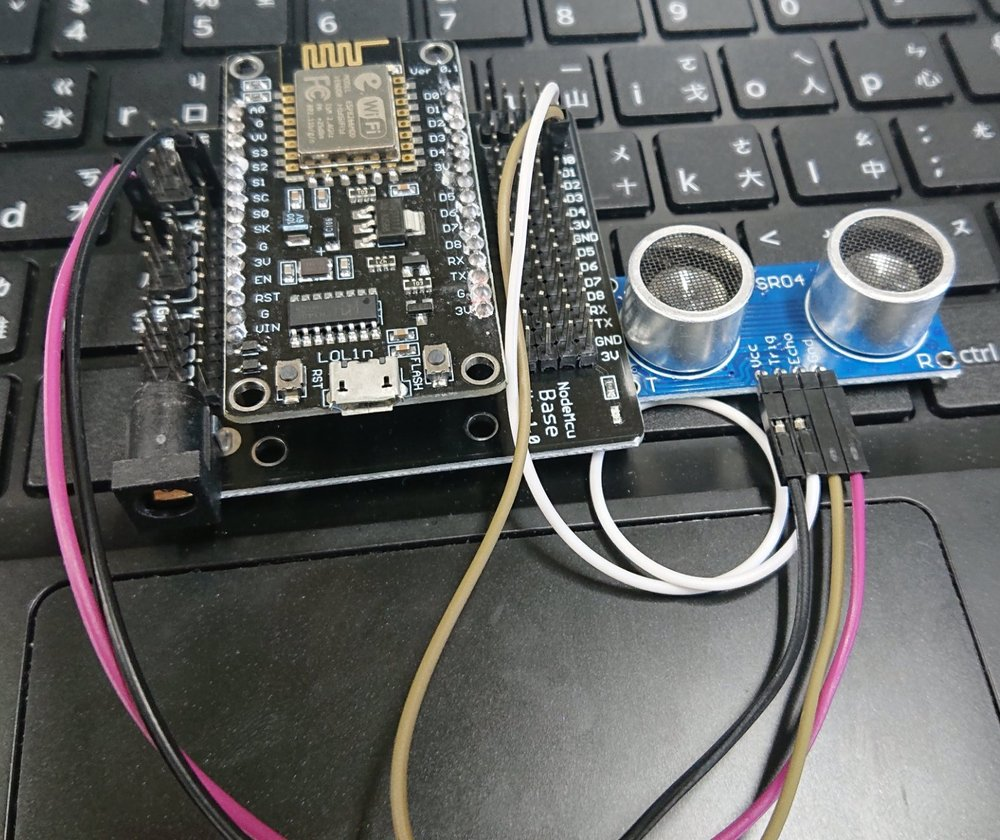
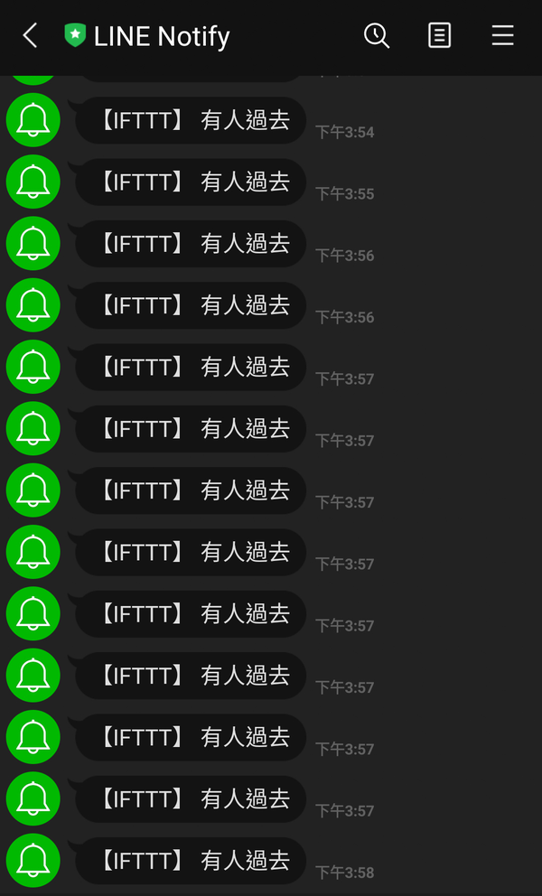

# Entrance Detector with LINE Alerts

A high school project: a low-cost device that notices when someone passes through a doorway and sends a notification to LINE. It runs on an ESP8266 (NodeMCU) board with an HC-SR04 ultrasonic sensor, is written in C/C++ with the Arduino IDE, and reaches LINE through IFTTT webhooks.

The code is uploaded as I wrote it back then. I only removed my credentials, translated the comments to English, and used the config variables inside the URL instead of repeating the literal values.

## How it works

1. On power-up, the ESP8266 connects to the configured Wi-Fi network and keeps retrying until it succeeds.
2. The HC-SR04 measures the distance at the doorway.
3. If the reading is below a threshold (30 cm in my initial test, which corresponds to a person taller than about 170 cm passing the sensor), the ESP8266 sends an HTTP request to an IFTTT webhook.
4. IFTTT sends a message to a LINE notification group.

## Hardware

| Part | Notes |
| --- | --- |
| NodeMCU ESP8266 Wi-Fi development board (with expansion base) | Runs the sketch |
| HC-SR04 ultrasonic sensor | Roughly 2-400 cm range, 5 V |
| Jumper wires | |

Pins used in the sketch:

| HC-SR04 | NodeMCU |
| --- | --- |
| Trig | D1 (GPIO5) |
| Echo | D2 (GPIO4) |

## Software

- Arduino IDE with the ESP8266 board package
- `ESP8266WiFi` (included with the ESP8266 core) and the `Ultrasonic` library (`Ultrasonic.h`)
- IFTTT Webhooks

## Setup

1. Open `entrance_detector/entrance_detector.ino` in the Arduino IDE.
2. Replace `YOUR_WIFI_SSID`, `YOUR_WIFI_PASSWORD` and `YOUR_IFTTT_KEY` with your own values. Keep `eventName` identical to the event name of your IFTTT applet.
3. Select your NodeMCU board, upload, and open the serial monitor at 9600 baud to see the connection status and distance readings.

## Results

- The board connected to Wi-Fi and recovered from failed connections automatically.
- The sensor returned usable distance readings, which the sketch compared against the threshold.
- IFTTT was triggered successfully, and LINE alerts were delivered when someone passed.

*Test run: LINE Notify alerts triggered by the device. Several alerts fired within the same minute because the sketch has no cooldown.*

## Known issues and ideas

- **Unstable readings:** ultrasonic sensing is affected by surface roughness and temperature, so the final device was less reliable than I hoped.
- **Network dependency:** the sketch contacts IFTTT on every loop iteration, so an unstable network stalls the whole device before any alert is sent.
- **No cooldown:** the loop has no delay, so one passage can trigger several notifications.
- **Timeout bug:** `millis()` returns an unsigned value, so `timeout - millis() < 0` is never true and the response timeout never fires. A correct version would store `unsigned long start = millis()` and check `millis() - start > 5000`.
- **Ideas:** add an infrared or face recognition module to improve accuracy, and add a cooldown between alerts.

## Note on LINE Notify

This project was built when LINE Notify was available. LINE ended the LINE Notify service on March 31, 2025, so the final step of the original pipeline no longer works. The sensing and webhook parts are unchanged; the notification would have to be redirected to another channel.
